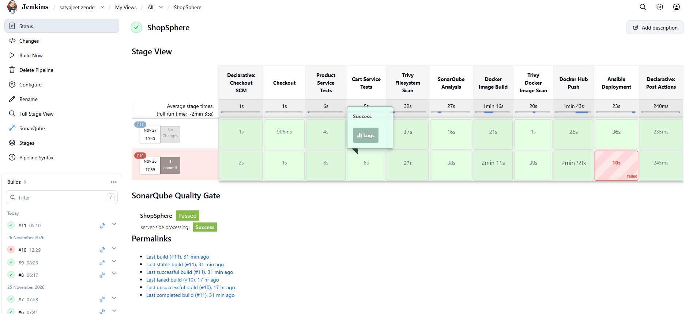
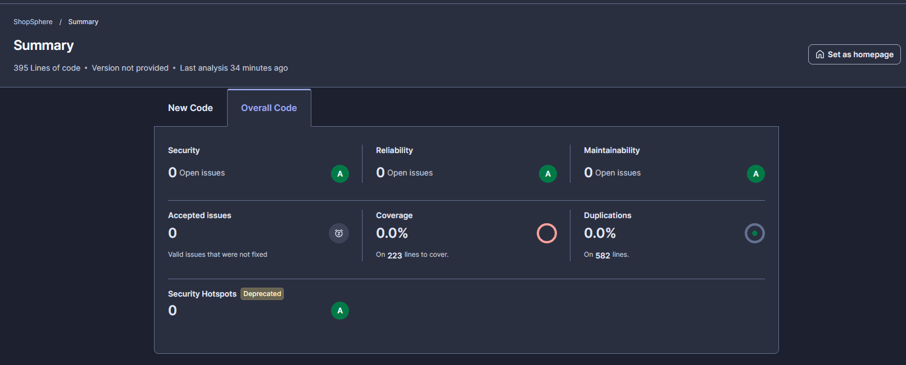
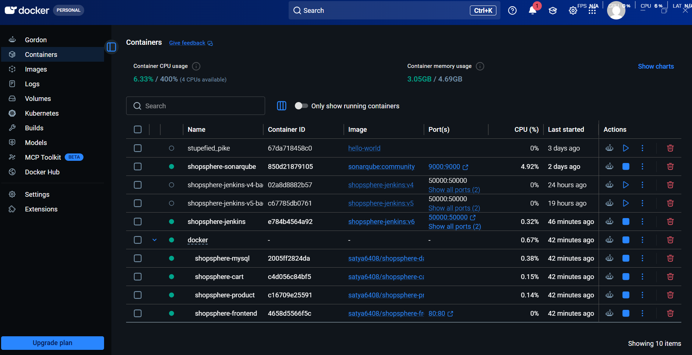
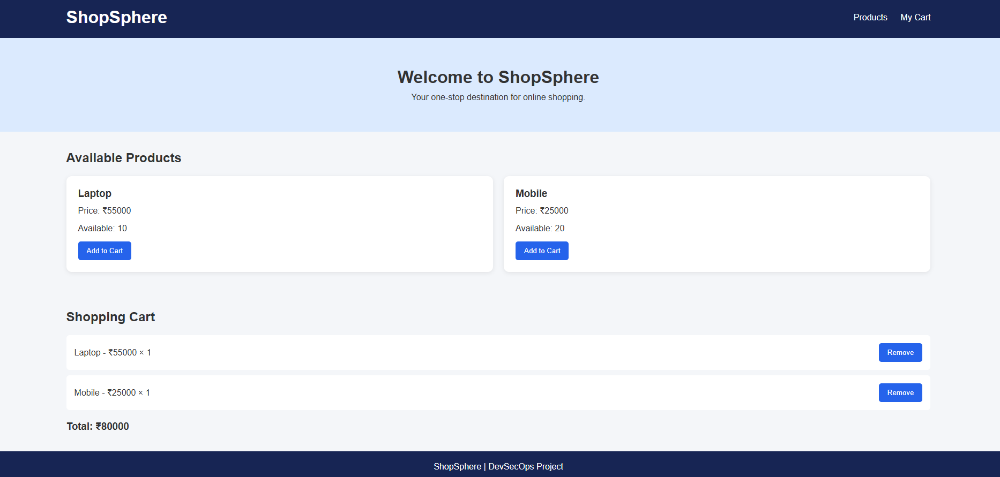

# ShopSphere – DevSecOps CI/CD Pipeline

An end-to-end DevSecOps project that automates testing, code quality analysis, security scanning, Docker image publishing and application deployment using Jenkins and Ansible.

## Project Overview

ShopSphere is a microservices-based e-commerce application consisting of:

- Product Service
- Cart Service
- Frontend with Nginx
- MySQL Database

The project demonstrates how DevOps and security practices can be integrated into a CI/CD pipeline to automate application delivery.

## Architecture

```text
                 Developer
                     |
                     v
                GitHub Repo
                     |
                     v
                  Jenkins
                     |
          +----------+----------+
          |                     |
          v                     v
     Product Tests         Cart Tests
          |                     |
          +----------+----------+
                     |
                     v
              Trivy FS Scan
                     |
                     v
                SonarQube
                     |
                     v
             Docker Image Build
                     |
                     v
             Trivy Image Scan
                     |
                     v
               Docker Hub
                     |
                     v
             Ansible Deployment
                     |
                     v
             Docker Compose
                     |
       +-------------+-------------+
       |             |             |
       v             v             v
    Product         Cart        Frontend
    Service        Service       (Nginx)
       |             |             |
       +-------------+-------------+
                     |
                     v
                  MySQL
```

## Technologies Used

| Category | Tools |
|---|---|
| Operating System | Linux / Ubuntu |
| Version Control | Git, GitHub |
| CI/CD | Jenkins |
| Containers | Docker, Docker Compose |
| Code Quality | SonarQube |
| Security Scanning | Trivy |
| Configuration Management | Ansible |
| Web Server / Reverse Proxy | Nginx |
| Database | MySQL |
| Application | Python, FastAPI |

## Project Structure

```text
ShopSphere/
│
├── Jenkinsfile
├── README.md
├── .gitignore
├── .env.example
├── sonar-project.properties
│
├── ansible/
│   ├── deploy.yml
│   └── inventory.ini
│
├── database/
│   ├── Dockerfile
│   └── init.sql
│
├── docker/
│   ├── docker-compose.yml
│   └── nginx.conf
│
├── frontend/
│   ├── Dockerfile
│   ├── nginx.conf
│   ├── index.html
│   ├── script.js
│   └── style.css
│
├── jenkins/
│   └── Dockerfile
│
└── services/
    ├── product-service/
    └── cart-service/
```

## Jenkins CI/CD Pipeline

The Jenkinsfile contains nine stages:

| Stage | Description |
|---|---|
| 1. Checkout | Retrieves source code from GitHub |
| 2. Product Service Tests | Executes product service tests |
| 3. Cart Service Tests | Executes cart service tests |
| 4. Trivy Filesystem Scan | Scans project files for security issues |
| 5. SonarQube Analysis | Performs code quality analysis |
| 6. Docker Image Build | Builds four application images |
| 7. Trivy Docker Image Scan | Scans container images |
| 8. Docker Hub Push | Publishes versioned and latest images |
| 9. Ansible Deployment | Pulls images and deploys the application |

## Docker Images

The pipeline builds and publishes these images:

- `satya6408/shopsphere-product`
- `satya6408/shopsphere-cart`
- `satya6408/shopsphere-frontend`
- `satya6408/shopsphere-database`

Images are tagged using the Jenkins build number and `latest`.

## Application Deployment

Ansible automates deployment using the Docker Compose configuration.

The playbook performs:

1. Docker installation check.
2. Docker Compose installation check.
3. Compose configuration validation.
4. Pull application images from Docker Hub.
5. Deploy containers.
6. Verify running container status.

The MySQL data is persisted using a named Docker volume.

## Run the Application Locally

### Prerequisites

- Docker Desktop with WSL2 integration, or Docker Engine with Docker Compose.
- Git.
- A configured `.env` file.

### 1. Clone the repository

```bash
git clone https://github.com/satya6408/ShopSphere.git

cd ShopSphere
```

### 2. Configure environment variables

```bash
cp .env.example .env
nano .env
```

Fill in the required values locally. Never commit `.env` or share its secrets.

### 3. Start the application

```bash
docker compose -p docker \
--env-file .env \
-f docker/docker-compose.yml up -d
```

### 4. Check containers

```bash
docker compose -p docker \
--env-file .env \
-f docker/docker-compose.yml ps
```

### 5. Stop the application

```bash
docker compose -p docker \
--env-file .env \
-f docker/docker-compose.yml down
```

**Note:** Do not use `down -v` unless you intentionally want to delete the persistent MySQL volume.

## Application URLs

When running locally:

| Component | URL |
|---|---|
| Frontend | http://localhost |
| Product API | http://localhost/api/products |
| Cart API | http://localhost/api/cart |
| Jenkins | http://localhost:8080 |
| SonarQube | http://localhost:9000 |

## Security Implementation

- Trivy filesystem scanning.
- Trivy container image scanning.
- SonarQube code quality analysis.
- Jenkins credentials for Docker Hub authentication.
- Jenkins secret-file credential for deployment environment variables.
- `.env` excluded from Git.

**Security note:** The current Trivy commands use `--exit-code 0`. Findings are reported but do not currently block the pipeline. Review and introduce appropriate security gates before production use.

## Current Deployment Verification

The successful Jenkins deployment verified four running containers:

- Product Service
- Cart Service
- Frontend
- MySQL (healthy)

API verification:

- Product API returned Laptop and Mobile records.
- Cart API returned two items.
- Cart total: ₹80,000.
- Frontend returned HTTP 200 OK.

## Future Improvements

- Introduce security gates for HIGH and CRITICAL vulnerabilities.
- Configure Docker credential helpers.
- Add automated rollback.
- Implement separate development, staging and production environments.
- Deploy to AWS infrastructure.
- Add monitoring and alerting.

## Author

**Satyajeet Zende**

GitHub: https://github.com/satya6408

Project: [ShopSphere – DevSecOps CI/CD Pipeline](https://github.com/satya6408/ShopSphere)

## Project Screenshots

### Jenkins CI/CD Pipeline


### SonarQube Dashboard


### Docker Containers


### ShopSphere Frontend


